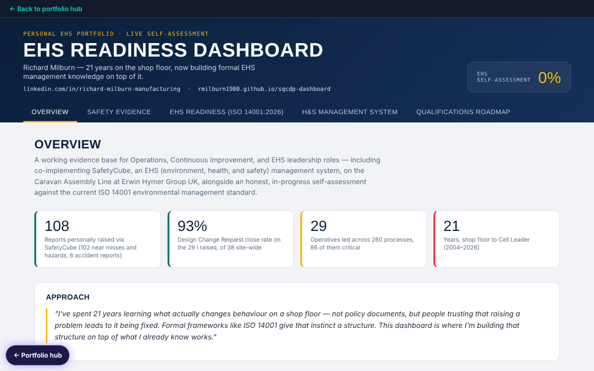

# EHS Readiness Dashboard

[Try it live](https://rmilburn1980.github.io/ehs-dashboard/) · [Portfolio hub](https://rmilburn1980.github.io/)

Live: https://rmilburn1980.github.io/ehs-dashboard/

Six tabs: an overview of my safety evidence, safety reporting figures from SafetyCube (an EHS management system), an ISO 14001:2026 self-assessment, the H&S management system laid out on the POPMAR model, a qualifications roadmap, and a regulatory intelligence maturity model with a 10 question scorer and a printable one-page interview summary (link straight to it with `#regint`).

The self-assessment is a self-assessment only. It is not an audit and does not show that any system meets a standard.

It is a single HTML page with no build step and no server. Data stays in your browser.

## About the figures

The figures in this project are my own. They come from my CV, an export of the SafetyCube incident log (April 2025 to March 2026) and my line performance tracker (August 2023 to July 2025). Where a figure rests on my own records and has not been independently checked, the page says so. Person-level skills detail is illustrative and names are anonymised. Nothing here is a statement that any process, site or person is safe or compliant.

Part of my portfolio: https://rmilburn1980.github.io/
